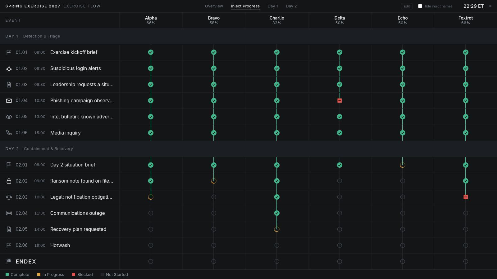

# Exercise Flow

A live progress board for multi-day exercises. Each column is a team (enclave, lane…), each row
an inject.



## Run it

**Windows, nothing to install:** download `ExerciseFlow.exe` from
[Releases](../../releases/latest), put it in its own folder and double-click it. Windows may warn
that the app is unrecognised: click **More info → Run anyway**. Your browser opens; the black
window shows a **setup code**. Enter it, choose the shared password, done. Keep that window open
while the exercise runs.

**Any computer with [Node.js](https://nodejs.org) 22+:** download this repository (green **Code**
button → **Download ZIP**, or `git clone`), then in its folder run:

```bash
npm start
```

Open the address it prints (<http://localhost:8080>). The terminal shows the **setup code** for
the first visit.

The startup message also lists the address other computers on your network can use (wall
screens, staff laptops).

## Use it

- **Overview**, **Inject Progress** and one page per **Day** are the viewing screens.
  **Hide inject names** (top right) blanks titles on screens participants can see.
- **Edit** (top right) has the status tabs, **Manage injects** (add, remove) and
  **Edit platform** (exercise name, column name, time zone, days, columns).
- Removed injects, days and columns keep their progress; add one back with the same ID or name
  and it returns.

Everything is kept in the `data/` folder next to the app. Delete `state.json` to reset
progress, `auth.json` to choose a new password, or the whole folder to start over.

## Share it over HTTPS

Install [`cloudflared`](https://developers.cloudflare.com/cloudflare-one/connections/connect-networks/downloads/)
and run `cloudflared tunnel --url http://localhost:8080`. It prints a public `https://…`
address. Anyone with that address and the password gets in, so choose a strong password.

## Develop

```bash
npm test             # tests
npm install && npm run build:exe   # executable for this OS, in build/ (needs Node from nodejs.org)
```

Pushing a tag such as `v1.0.0` builds the Windows and Linux executables and attaches them to a
GitHub Release.

[MIT licence](LICENSE)
